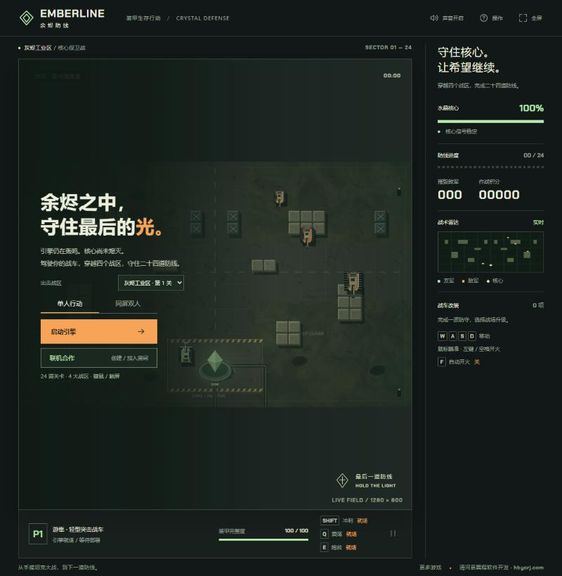

<div align="center">

# 余烬防线 · EMBERLINE

**守住核心，让希望继续。**

单人、同屏双人或两台设备联机合作，穿越灰烬工业区、霜线中继站、熔炉禁区、虚空裂隙，完成 24 关并击败四位首领。<br>
图形与音效全部由代码实时生成，不依赖任何图片或音频素材。

### [▶ 在线试玩](https://hbycrj.com/games/tank/) &nbsp;·&nbsp; [🎮 翼程游戏大厅](https://hbycrj.com/games/)

作者：[清河县翼程软件开发](https://hbycrj.com) · [hbycrj.com](https://hbycrj.com)

<a href="https://hbycrj.com/games/tank/"></a>

</div>

## 在线试玩

打开 **<https://hbycrj.com/games/tank/>** 即可游玩，支持电脑与手机浏览器。更多游戏见 **[翼程游戏大厅](https://hbycrj.com/games/)**。

## 启动与联机

需要 Node.js 20 或更新版本。首次安装依赖后启动：

```powershell
npm install
npm start
```

本机打开 **http://localhost:8080/index.htm**。同一网络的队友使用启动日志输出的局域网网址；房间里的邀请链接也会优先使用本机局域网地址。多个网卡时请确认选择双方可访问的地址。

1. 选择出击战区，点击「联机合作 → 创建房间」。
2. 将邀请链接或 6 位数字房间码（界面显示为「123 456」，方便语音报号）交给队友；队友从同一个服务器网址加入。
3. 两人点击「我已准备」，房主点击「两人出击」。
4. 两人都使用自己的 WASD、鼠标和技能键。每波改装由两人投票；意见不同时采用房主选择。

服务器统一计算双方移动、敌人、伤害、核心、掉落、事件和升级。客户端不能提交血量、坐标或积分。刷新可凭当前标签页保存的令牌恢复原席位。意外断线立即冻结作战，保留一分钟恢复窗口；主动离开关闭整个双人房间。两人共享暂停，任一人可继续；刷新前触发的主动暂停需要点击继续。房间不保存到磁盘，重启服务会结束现有房间。

**异地联网**：将同一份项目和 Node 服务部署在两人可访问的主机上，使用同一个公开网址。HTTPS 入口对应 WSS；反向代理须转发 WebSocket Upgrade，并将 `/ws` 和静态资源转到同一服务。默认监听 `0.0.0.0:8080`，可用 `PORT`、`HOST` 环境变量修改。局域网无法连接时检查地址、8080 端口与主机防火墙。本项目不会自动开放防火墙或建立公网隧道。

只玩单人或同屏模式时，也可继续使用 Python 3：

```powershell
py -m http.server 8000 --bind 127.0.0.1
```

此入口为 **http://127.0.0.1:8000/index.htm**，不提供房间服务。原生 ES Modules 需要 HTTP，不能直接双击 HTML 文件运行。

Windows + NGINX 的公网配置、启动脚本和后台运行步骤见 [部署指南](deploy/windows/README.md)。

支持挂载到子目录（如 `https://hbycrj.com/games/tank/`）：接口、联机和分享链接会跟随应用目录。将 [子目录代理片段](deploy/windows/nginx-games-tank-locations.conf.example) 加入域名现有的 NGINX server 块，后端仍运行在 8080。

## 怎么玩

- **目标**：守住地图下方核心。四个战区各六关，提供不同掩体地图、敌军配置、事件和首领；菜单可直接从任一战区开始，并获得对应基础装备。
- **玩家 1 / 联机双方**：WASD 移动，鼠标瞄准，按住左键或空格开火。Shift 冲刺，Q 震荡清弹，E 部署炮台，F 自动开火。
- **同屏玩家 2**：方向键移动并自动瞄准，小键盘 0 / Enter 开火，小键盘 1 / 右 Shift 冲刺，小键盘 2 / 右 Ctrl 震荡，小键盘 3 部署炮台。
- **触屏**：左摇杆移动，右侧开火、冲刺、震荡和炮台按钮；自动瞄准附近敌军。
- **全局**：Esc / P 暂停，M 声音，页头提供手册和全屏。离开页面自动暂停。
- **成长**：每关结束全员修复 35 装甲、核心修复 15 耐久；19 种改装按普通 / 稀有 / 传说稀有度加权三选一，每局可刷新 2 次（按 R）。凑齐指定组合会必定出现进化改装：弹球炸弹（跳弹 + 高爆）、雷霆僚机（僚机 + 致命校准）、血色连爆（殉爆 + 吸能）、激光哨塔（哨戒 + 贯穿）、永动狂热（狂热回路 + 磁吸）。维修模块吸附后修复 22 装甲、8 核心耐久。
- **无尽模式**：主菜单「作战模式」选择无尽后，打完 24 波不结算胜利，而是按 6 波一换循环战区进入下一轮；每轮敌军耐久 +35%、数量 +25%，直到防线失守。本机记录最远波次，联机由房主创建房间时选择。
- **档案（成就与图鉴）**：16 项成就（如百连斩、核爆专家、完全进化、首领猎手、无尽五十波、余烬终焉），首次达成发放余烬碎片；图鉴记录击毁过的敌军（含累计击毁数）、获得过的特装武器与改装，未发现条目显示为「？？？」。
- **局外成长（机库）**：每局按积分、肃清波数与胜负获得余烬碎片，存于本机。可解锁重炮（犀牛）、速射（黄蜂）、工程（工蜂）底盘，购买装甲、核心、刷新、狂热、先发特装、打捞六项永久天赋。底盘可用于联机；永久天赋只在单人与同屏双人生效。
- **余烬等级**：从第 1 关打通全部战役解锁下一级，共 10 级，逐级叠加敌军耐久、精英、移速、核心过载、火力、数量、补给短缺、首领耐久、刷新减少与狂热减速等词条；每级结算碎片 +15%。联机由房主创建房间时选择等级。
- **波次评级**：按本波承伤与最高连击评出 S / A / B / C，奖励 1500 / 800 / 300 积分，S 级额外获得 1 次刷新。击毁有五声音阶音效与残骸碎片，首领终结触发慢动作。
- **炮台**：持续 12 秒，冷却 22 秒，自动射击附近敌人；可通过改装强化。
- **战场事件**：橙色电池提供 8 秒双倍射速；炮击圈在 1.6 秒预警后爆炸，能同时伤害敌军；在信标附近排除敌人并坚守 4 秒，可修复核心 65、全员装甲 30 并获得 500 分。新增「火力全开」（开波配发随机特装武器、武器掉率 ×3）、「燃料油桶阵」（射爆油桶连环殉爆）与「蜂群潮汐」（边缘持续涌入无人机）。
- **特装武器**：击毁敌军随机掉落扇面弹幕、贯穿激光、追踪飞弹、连锁闪电与清屏核弹；精英必掉，首领爆出一圈武器与核弹。
- **爽快系统**：击杀积攒狂热值，满值进入 8 秒狂热模式（射速翻倍、伤害 +35%、受伤减半、拾取范围扩大）；连击不封顶、积分倍率最高 ×5；短时间连续击毁触发连杀播报。每波战场散布可射爆的燃料桶。
- **重建**：阵亡 7 秒后消耗核心 40 耐久重建。全员阵亡且能量不足，或核心被毁，行动失败。

敌军包括掠袭者、突击战车、远射猎手、重装堡垒、自爆突击车、战地工兵、自行火炮、裂变母车，以及成队冲锋的蜂群无人机、近距离喷火战车、预警后发射贯穿光束的棱镜炮车和释放无人机的蜂巢母舰。第 4 关起敌军可能带有迅捷、重甲或爆裂精英词缀；首领在 66% 与 33% 耐久时进入新阶段并召唤蜂群。灰烬之王使用环形弹幕；霜脊堡垒使用低速冷色扇形弹；熔炉主宰追加落点炮击。

## 实现与验证

`js/game.js` 为服务器与单机共用模拟器；`js/config.js` 管理战区、关卡和改装；`server/rooms.js` 管理房间与权威战斗；`server/index.js` 提供 HTTP / WebSocket；`js/network.js` 上传操作、恢复房间并插值显示快照；`js/protocol.js` 校验输入、生成精简快照。

`js/renderer.js` 绘制战场、炮击、信标、炮台与打击反馈；`js/sound.js` 混合 Web Audio，`js/synthesis.js` 生成缓存 PCM。按 `100dvh` 布局，页面不纵向滚动；长表单、手册在自身区域滚动。字体、游戏图形和声音不依赖外部 CDN。Chakra Petch 字体许可证见 `fonts/OFL-ChakraPetch.txt`。

```powershell
npm test
git diff --check
```

测试包括规则回归、二十四关与四首领结算、新敌人与新改装、战区地图、事件、音频，以及真实双 WebSocket 客户端的房间、移动、技能、暂停、重连、投票和资源访问边界。双浏览器标签可检查同步与刷新恢复；这不能代替两台实体设备、跨公网延迟、真人难度或主观音质与手感验证。

## 作者

由 **[清河县翼程软件开发](https://hbycrj.com)** 开发并开源。更多作品见 [翼程游戏大厅](https://hbycrj.com/games/)。

我们承接小程序、App、网站与企业软件定制开发，详见官网 [hbycrj.com](https://hbycrj.com)。

## 许可

本项目源码以 [MIT License](LICENSE) 开源。

| 第三方组件 | 许可 |
|---|---|
| [ws](https://github.com/websockets/ws)（npm 依赖） | MIT |
| [Chakra Petch](https://fonts.google.com/specimen/Chakra+Petch) 字体 | SIL Open Font License 1.1，见 `fonts/OFL-ChakraPetch.txt` |
